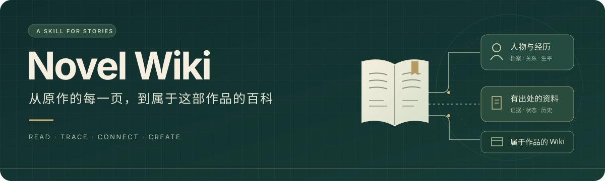

  

  <strong>为值得被认真记录的故事，建立一部有出处的百科。</strong> 
  TXT / EPUB 全文 · 人物与世界观 · SQLite 资料库 · 静态 Wiki

  
  
  
  

  <a href="#quick-start">快速开始</a> ·
  <a href="#workflow">工作流程</a> ·
  <a href="#example">查看示例</a> ·
  <a href="#scope">能力边界</a> ·
  <a href="https://github.com/Shadose2024/novel-wiki/releases/tag/v1.0.0">下载首版</a>

---

## 一本书，可以被整理成什么？

冷门作品往往缺少现成百科，人物关系、设定限制与散落各章的小细节，都需要读者自己查找。**Novel Wiki** 是一个面向这类作品的 agent skill：让 agent 沿着全文提取、复核和整理资料，再用这些资料搭建百科。

人物既有便于查阅的档案，也有连贯的经历；设定保留适用条件和阶段变化；正文可以回到具体依据。

| 你提供 | 逐步得到 |
| :--- | :--- |
| 一部作品的 TXT、EPUB 等全文 | 可定位的来源与处理范围 |
| 想优先整理的人物、设定或章节 | 带证据的人物、地点、组织、物品、事件与关系资料 |
| 对条目细节和写作风格的反馈 | 可编辑、可续做、有修改历史的 SQLite 数据库 |
| 对作品气质与阅读体验的偏好 | 人物及设定条目，以及使用 SVG / CSS 美术的静态 Wiki |

> **首版重点：先把原作百科资料做好。** 脚本负责存储、分包和校验；阅读理解、语义归并与网站设计由执行 skill 的 agent 完成。你可以只做资料整理，网站留到以后。

## 快速开始

**运行环境：** 能读取本地文件、运行终端并写作的 Codex agent；Python **3.10+**。随附脚本仅使用 Python 标准库，无需本项目专用的 API key。模型调用费用取决于你使用的 agent 环境。

### 1. 安装

在 Codex 中发送：

~~~text
使用 skill-installer 安装 GitHub 仓库 Shadose2024/novel-wiki，
版本 v1.0.0，仓库内路径为 .，安装名为 novel-wiki。
~~~

<strong>手动安装</strong>

从 [Releases](https://github.com/Shadose2024/novel-wiki/releases/tag/v1.0.0) 下载 **novel-wiki-v1.0.0.zip**，解压后将整个 **novel-wiki** 文件夹放到 **~/.codex/skills/**。设置了 CODEX_HOME 时，使用其下的 skills 目录。

确保目录结构为 **skills/novel-wiki/SKILL.md**，并保留所有子目录。更新已有版本时先备份，再整体替换，避免混入旧文件。

### 2. 从少量章节开始

安装后，在下一轮对话中附上电子书或提供文件路径，并发送：

~~~text
$novel-wiki
请根据我提供的小说全文制作原作百科。
先用少量连续章节试跑，完成提取、复核和条目草稿，保存到 SQLite。
人物条目同时包含档案和连贯经历，尽量保留有辨识度的细节。
这次只做资料整理，结束时保存进度与待查事项。
~~~

先看一篇人物条目和一篇设定条目是否符合预期，再扩展到更多章节。换模型或中断后，让 agent 读取数据库和交接记录即可续做。

### 3. 资料满意后，再制作网站

~~~text
$novel-wiki
读取已有数据库和交接记录，继续制作静态 Wiki。
默认没有插画，请根据作品气质设计 SVG 和 CSS。
提供分类、中文搜索、条目互链、出处和本地浏览方式。
~~~

## 两个阶段，一份可持续编辑的资料库

~~~mermaid
flowchart LR
    A[TXT / EPUB 全文] --> B[定位来源 · 小包阅读]
    B --> C[提取事件与细节]
    C --> D[复核 · 补漏 · 跨章整理]
    D --> E[(SQLite 资料库)]
    E --> F[人物与设定条目]
    F --> G[静态 Wiki · SVG / CSS]
    D -. 待查问题回到原文 .-> B
    classDef source fill:#eef6f3,stroke:#4d8276,color:#173e35
    classDef store fill:#f6f0e2,stroke:#b39453,color:#59451f
    class A,B,C,D source
    class E,F,G store
~~~

| | 阶段 A · 原作资料 | 阶段 B · 百科网站 |
| :--- | :--- | :--- |
| **主要工作** | 提取、复核、归并、确认、成文 | 信息结构、页面设计、SVG 美术、浏览检查 |
| **模型建议** | 先用较便宜模型试跑小批量任务 | 可切换到预算内能力较强的前端与视觉模型 |
| **交付内容** | SQLite、证据、条目草稿、进度与待查事项 | 静态站、源文件、运行方法与资料覆盖说明 |

每阶段只提示一次模型选择，沿用用户已选模型。交接文件记录来源范围、数据库位置和下一项任务，帮助后续会话接着工作。

### 为长篇阅读和有限模型能力设计

- **一次只做一件事。** 默认每个阅读包约 2,200 个正文字符；事件、细节分开提取，按实际表现调整大小。
- **按需读取说明。** 简短入口指向阶段参考，避免每个阅读包都附上全书、数据库结构和建站规范。
- **把机械工作交给脚本。** 分包、记录 ID、证据切片、版本检查和导出由工具处理，模型集中做理解与写作。
- **把进度落到文件。** 已读、已提取、已核对分别记录；结构错误局部修复，未解问题留待后续处理。

这些是流程设计，**尚不构成对某个模型准确率、费用或全文效果的保证**。

### 资料怎样逐步确认？

首轮保留「判断」标签；随后约十章或大情节收束时，结合上下文复核为「初步确定」；全文读完后，未被后文明显推翻的资料集中采用为事实。

确认过程始终保留内部来源、说话人和修改历史。「计划修桥」即使得到确认，也仍然是一项计划；后文写到完工时，另记完成事件。原文缺失、整理者猜测和真正的矛盾需要单独处理，不能仅凭沉默补全。

→ 详细规则见 [确认流程](references/confirmation.md)；编辑与存取见 [数据库接口](references/storage.md)。

## 看一次从原文到条目的过程

仓库附带专门编写的两章短文。下面展示的是合成示例，不涉及现有作品。

| 原文片段 | 整理时保留的信息 |
| :--- | :--- |
| 阿青是河湾村的木匠。她准备修桥，估计需要约十天。 | 身份：木匠；修桥：计划；工期：估计约十天 |
| 十二天后，木桥完工并开放通行。阿青把图纸交给学徒小禾。 | 完工与通行：已发生；图纸交接与人物关系：保留出处 |

条目需要把这些信息组织成可查阅的档案和连贯经历，而不是将“预计十天”改写成“十天完工”。

**在仓库根目录运行：**

~~~sh
python examples/demo.py --out demo-output
python scripts/wiki.py --db demo-output/wiki.sqlite status --limit 5
~~~

你会得到：

~~~text
demo-output/
├── wiki.sqlite       资料、来源、证据与修改历史
└── review/qing.md    人物档案与经历示例（另有配套输出）
~~~

打开 **demo-output/review/qing.md** 查看条目。示例的提取结果预先编写，**不调用模型、不评价提取准确率**；重复运行请换一个新的输出目录，避免覆盖已有修改。

## 第一版做到哪里了？

| 内容 | 当前状态 |
| :--- | :--- |
| SQLite 存取、修改历史、证据与正文引用检查 | 已提供工具；通过 9 项合成数据回归检查 |
| 阅读包、确认状态、进度查看与导出 | 已提供工具与使用规范 |
| 提取、补漏、跨章归并、人物与设定写作 | 已提供 agent 流程；经过少量中文小说片段迭代试跑 |
| TXT / EPUB 正文读取 | 由 agent 根据当前环境处理；未内置通用电子书解析器 |
| 章节阅读状态与跨记录关系编辑 | 由 agent 使用 SQL 事务维护并记录修改历史 |
| 静态网站与 SVG / CSS | 已提供建站规范；按作品生成，尚无统一网页模板 |
| 整本作品的语义质量与模型性能对比 | 尚未完成独立系统评估 |
| 云端部署、注册、多人协作 | 留待后续需求，首版专注本地资料与静态站 |

早期试跑在同一对话中迭代，没有可靠的模型 ID、调用成本记录或独立盲测。工具校验成功，只能证明相应结构和引用规则通过，内容仍需对照原作复核。

<strong>常见问题</strong>

**没有插画也能做网站吗？** 这是默认场景。阶段 B 用 SVG 与 CSS 设计视觉，但人物外貌、地图关系和阵营符号等具体内容仍须有原作依据；装饰设计不能被误读为原作设定。

**可以只建数据库吗？** 可以。明确要求只执行阶段 A，保存进度后再决定是否建站。

**会把整本书公开出去吗？** 仓库不包含试跑小说或个人数据库。公开站点默认只导出所需条目、必要短引文和出处，完整原文与工作数据库保留在本地。

**其他 agent 可以使用吗？** 主流程是 Markdown，脚本使用标准 Python；目前安装与调用说明以 Codex 为主，其他宿主尚未逐一验证。

## 目录与维护

~~~text
novel-wiki/
├── SKILL.md              模型读取的简短入口
├── references/           按需加载的提取、确认、存取、建站流程
├── scripts/              SQLite、分包、确认、进度和导出工具
├── agents/openai.yaml    Codex 展示信息
├── examples/demo.py      可运行的合成示例
├── tests/                存储与引用行为检查
└── docs/banner.svg       README 的原创矢量横幅
~~~

运行检查：

~~~sh
python -m unittest discover -s tests -v
~~~

欢迎在 [Issues](https://github.com/Shadose2024/novel-wiki/issues) 反馈遗漏、错误归因或难以续做的场景。附上最小复现步骤、预期结果、实际结果和可分享的合成片段，会更容易定位问题。提交改进时，请说明它解决的具体阅读或编辑问题。

[更新记录](CHANGELOG.md) · [Skill 入口](SKILL.md) · [MIT 许可证](LICENSE)

---

从原文出发，让人物、经历与世界观都有据可查。

